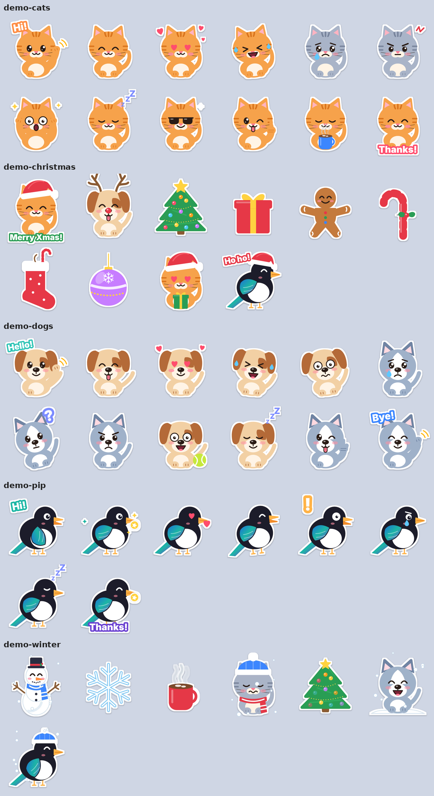

# Sticker Shim demo packs

Original demo sticker packs for [Sticker Shim](https://github.com/Gornoka/sticker_shim): for trying the import and for
the app's release screenshots. All art is drawn in code (`art/`), no third-party images.

| Pack | Identifier | Stickers | Kind | Group |
|---|---|---|---|---|
| Demo Cats | `demo-cats` | 12 | still | Pets |
| Demo Dogs | `demo-dogs` | 12 | still | Pets |
| Pip the Magpie | `demo-pip` | 8 | still | Pets |
| Demo Snow Days | `demo-winter` | 7 | animated | Winter |
| Demo Christmas | `demo-christmas` | 10 | still | Winter › Christmas |

Pip the magpie is Sticker Shim's mascot.



## Import into the app

- **Everything with groups:** download `sticker-shim-demo.zip` from the
  [latest release](../../releases/latest), then *+ → Import .zip*. The packs arrive as editable own packs in the groups
  *Pets* and *Winter* (with the subgroup *Christmas*).
- **One pack:** download `<identifier>.zip` from the release and import it the same way. It arrives as a read-only
  imported pack (plain `publish.py` layout, no `shim.json`).
- **By URL:** *+ → Add URL* with
  `https://raw.githubusercontent.com/Gornoka/sample_stickery/main/site/index.json`. Imports all packs read-only,
  without groups.

## Layout

```
art/        art.py (characters, props), packs.py (packs, stickers, names, emojis, groups), renderer
images/     rendered 512x512 PNGs and animated WebPs, one folder per pack (plus tray.png)
packs/      stickers.py make output (contents.json with names and emojis)
site/       stickers.py publish output: index.json plus pack folders, served for URL import
build.py    images/ -> packs/ -> site/ (needs a sticker_shim checkout for tools/stickers.py)
release.py  site/ -> dist/*.zip (stdlib only)
```

## Rebuild

Needs Python 3.14, [uv](https://docs.astral.sh/uv/), Node with Playwright and Chromium (renderer), and a checkout of
`sticker_shim` next to this repository.

```sh
python art/build_images.py images            # render; optional args: pack ids or <id>/<stem> to render only those
python art/sheet.py images preview.png       # contact sheet
python build.py --tools ../sticker_shim/tools
python release.py                            # dist/*.zip
```

## Release

Push a tag `v<N>`: the `Release` workflow runs `release.py` and attaches `dist/*.zip` to a GitHub release, with
`RELEASE_NOTES.md` as the text. Without Actions: `python release.py`, then
`gh release create v<N> dist/*.zip --notes-file RELEASE_NOTES.md`.
